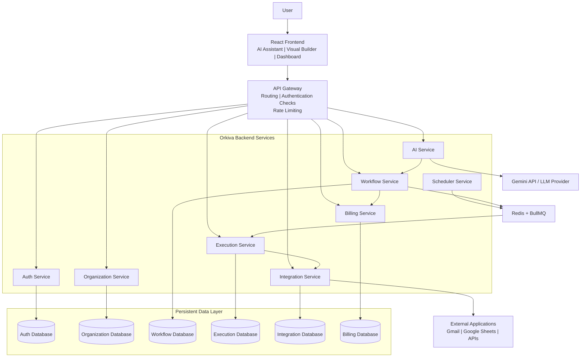
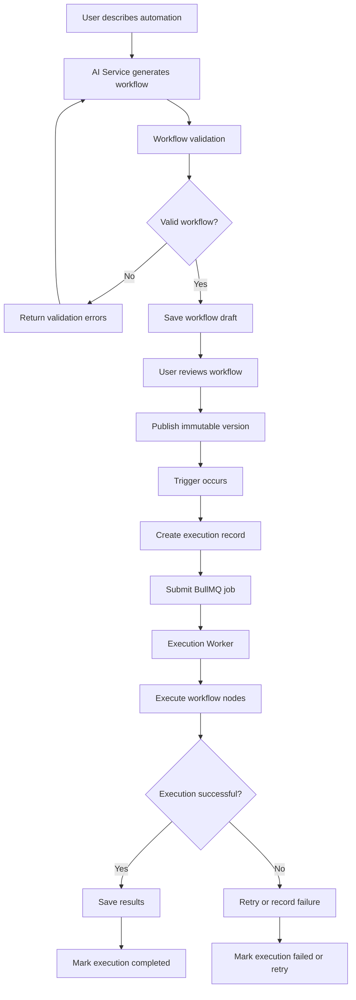
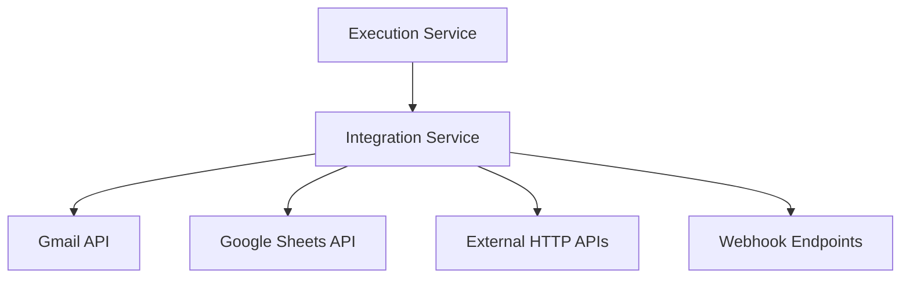

# Orkiva — System Architecture

> Automate anything. Just describe it.

**Document:** Technical Architecture  
**Version:** 1.0  
**Status:** Initial Architecture Proposal

---

# 1. System Overview

Orkiva is a general-purpose AI-powered workflow automation platform.

Users describe automation requirements using natural language. The AI system converts those instructions into structured workflow definitions. Users can inspect and modify these workflows through a visual editor before publishing them.

The execution engine runs published workflows using background jobs, integrations and scheduled triggers.

The platform follows a service-oriented architecture with independently defined microservice boundaries.

# 2. High-Level Architecture

The following diagram illustrates the major components and their relationships.



# 3. Frontend Layer

Technology:
- React
- Vite
- Tailwind CSS
- React Flow

Responsibilities:

1. User authentication screens.
2. AI automation assistant.
3. Visual workflow builder.
4. Workflow configuration.
5. Workflow publishing.
6. Execution history.
7. Error and result visualization.
8. Workspace management.

The frontend communicates with backend services through the API Gateway.

# 4. API Gateway

The API Gateway acts as the main entry point for frontend API requests.

Responsibilities:

- Route incoming requests.
- Verify access tokens or delegate authentication checks.
- Apply rate limiting.
- Validate common request metadata.
- Generate request and correlation IDs.
- Handle common API errors.

The Gateway should not contain business logic belonging to individual services.

# 5. Backend Services

## 5.1 Auth Service

Responsibilities:
- User registration.
- Login and logout.
- Password hashing.
- Access token generation.
- Refresh token rotation.
- Session management.
- Token revocation.

Database ownership:
- Users.
- Credentials and password hashes.
- Refresh sessions.
- Revoked token/session records.

## 5.2 Organization Service

Responsibilities:
- Create workspaces.
- Manage organization members.
- Manage roles and permissions.
- Enforce workspace membership.

Database ownership:
- Organizations.
- Organization memberships.
- Roles and workspace settings.

## 5.3 Workflow Service

Responsibilities:
- Create workflows.
- Update workflow drafts.
- Validate workflow definitions.
- Publish workflows.
- Maintain workflow versions.
- Retrieve workflow definitions.

Database ownership:
- Workflows.
- Workflow versions.
- Workflow metadata.

Published workflow versions should be immutable so existing executions can refer to a stable definition.

## 5.4 AI Service

Responsibilities:
- Understand natural-language instructions.
- Identify triggers, actions and conditions.
- Generate structured workflow JSON.
- Explain generated workflows.
- Suggest workflow modifications.
- Ask users for missing information.

Technology:
- Gemini API initially.
- Structured outputs.
- Zod validation through the appropriate workflow validation boundary.

Important security rule:

AI must never execute arbitrary generated JavaScript, SQL or shell commands.

It can only propose supported workflow nodes and configurations.

## 5.5 Execution Service

Responsibilities:
- Receive workflow execution jobs.
- Load published workflow versions.
- Execute nodes in dependency order.
- Pass data between nodes.
- Evaluate conditions.
- Handle branching.
- Maintain execution state.
- Record step results.
- Handle retries and timeouts.
- Support cancellation and eligible recovery.

Database ownership:
- Executions.
- Execution steps.
- Execution results.
- Execution errors.

## 5.6 Integration Service

Responsibilities:
- Manage connected applications.
- Handle OAuth authorization.
- Refresh integration tokens.
- Execute supported external application actions.
- Handle integration errors.
- Apply external API rate limits.

Initial integrations:
- Gmail.
- Google Sheets.
- Generic HTTP requests.
- Webhooks.

Credentials must be encrypted at rest. Services should never expose access tokens to the frontend.

## 5.7 Scheduler Service

Responsibilities:
- Manage scheduled workflow triggers.
- Handle recurring schedules.
- Process cron expressions.
- Handle user time zones.
- Dispatch workflow execution jobs at the correct time.

The Scheduler Service submits jobs to the execution queue rather than executing workflows itself.

## 5.8 Billing Service

Responsibilities:
- Manage subscriptions.
- Track usage.
- Enforce workflow and execution quotas.
- Manage plan limits.
- Process payment-provider webhooks.

Billing checks should happen before a workflow is accepted for execution when applicable.

# 6. Communication Architecture

Orkiva uses two main communication approaches.

## 6.1 Synchronous Communication

Technology: HTTP REST APIs.

Used when an immediate response is needed.

Example:

```text
Frontend
   |
API Gateway
   |
Workflow Service
   |
Database
   |
Response
```

## 6.2 Asynchronous Communication

Technology: Redis + BullMQ.

Used for background execution and long-running operations.

Example:

```text
Workflow Service
       |
       v
Redis / BullMQ
       |
       v
Execution Worker
       |
       v
Integration Service
       |
       v
External Application
```

RabbitMQ may be introduced later for durable service-to-service domain events when required.

BullMQ and RabbitMQ are not interchangeable design decisions; each should have a clearly defined responsibility.

# 7. Workflow Execution Lifecycle

A workflow follows this lifecycle:



# 8. Background Job Architecture

Redis and BullMQ will support background workflow execution.

Responsibilities:

- Job creation.
- Queue processing.
- Worker concurrency.
- Retry policies.
- Delayed execution.
- Job status tracking.
- Failed job handling.

Important concepts:
- Idempotency.
- Exponential backoff.
- Job timeouts.
- Duplicate job prevention.
- Safe recovery.
- Dead-letter handling.

The database remains the source of truth for workflow and execution state. Redis should not be the only place where important execution history is stored.

# 9. Database Architecture

PostgreSQL is the primary persistent database.

Initial logical database ownership:

| Service | Data |
|---|---|
| Auth | Users, sessions |
| Organization | Workspaces, memberships |
| Workflow | Definitions, versions |
| Execution | Execution records, step results |
| Integration | Connections, credential references |
| Billing | Subscriptions, usage records |

We can initially run one PostgreSQL server with separate databases or clearly isolated schemas. Services must not directly read or write another service's private tables.

# 10. External Integrations

The Integration Service connects Orkiva to external applications.



Each integration should define:
- Authentication requirements.
- Supported triggers.
- Supported actions.
- Input schema.
- Output schema.
- Error handling.
- Rate limits.

# 11. Security Architecture

Security requirements:

1. Secure password hashing.
2. Access and refresh token protection.
3. Workspace-level authorization.
4. Tenant data isolation.
5. Encrypted third-party credentials.
6. API rate limiting.
7. Input validation.
8. Audit logging.
9. SSRF protection for HTTP actions.
10. Approval for sensitive workflow operations.

# 12. Observability

The platform should provide:

- Structured application logs.
- Request correlation IDs.
- Workflow execution IDs.
- Step-level logs.
- Error tracking.
- Service health checks.
- Metrics.
- Distributed tracing as the architecture grows.

# 13. Deployment Architecture

Initial infrastructure:

```text
Cloud Server
    |
    +-- Nginx
    |
    +-- Frontend Container
    |
    +-- API Gateway Container
    |
    +-- Backend Service Containers
    |
    +-- PostgreSQL
    |
    +-- Redis
```

Services initially run on shared infrastructure using Docker Compose.

Independent scaling and more complex orchestration can be introduced when actual usage requires it.

# 14. Architectural Decisions

| Decision | Initial choice |
|---|---|
| Architecture | Service-oriented / microservice boundaries |
| Programming language | JavaScript |
| Frontend | React + Vite |
| Backend | Node.js + Express |
| Database | PostgreSQL |
| ORM | Prisma |
| Job queue | Redis + BullMQ |
| Event messaging | RabbitMQ when needed |
| AI provider | Gemini initially |
| Workflow editor | React Flow |
| Validation | Zod |
| Containerization | Docker |
| Local orchestration | Docker Compose |

# 15. Current Architecture Status

**Status:** Initial architecture proposal.

This architecture will evolve as implementation, testing and customer feedback reveal new requirements.

Our priority is to build a reliable workflow automation engine with clear service boundaries, not to introduce unnecessary infrastructure complexity.
```

## 1. Important improvements over your drawing

I've made three important architectural distinctions:

1. **API Gateway:** Handles incoming frontend requests. Internal background jobs don't need to pass through it.
2. **BullMQ:** The Scheduler and Workflow Service can dispatch jobs; Execution Workers consume them.
3. **PostgreSQL:** Each service owns its data. The database is not a shared workspace where every service can freely modify every table.

Also, RabbitMQ is optional initially. We don't need both BullMQ and RabbitMQ doing the same work.

## 2. What your repository should look like

```text
Orkiva/
│
├── docs/
│   ├── VISION.md
│   ├── COMPETITOR_ANALYSIS.md
│   └── ARCHITECTURE.md
│
└── README.md
```

## 3. Your next task

- [ ] Update `docs/ARCHITECTURE.md`.
- [ ] Add the Mermaid diagrams.
- [ ] Open the file on GitHub and check that diagrams render.
- [ ] Read the workflow execution lifecycle carefully.
- [ ] Understand which services own which data.

**One important engineering question:** In this architecture, why should the Execution Service use the Integration Service to send an email instead of directly calling the Gmail API itself?

Once you've answered that and shared your updated diagram, we'll finish Day 3 and move to Day 4: creating the actual Node.js monorepo for Orkiva.